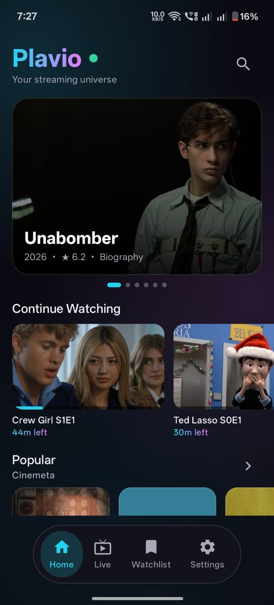
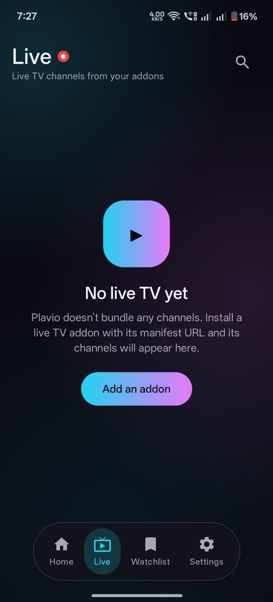
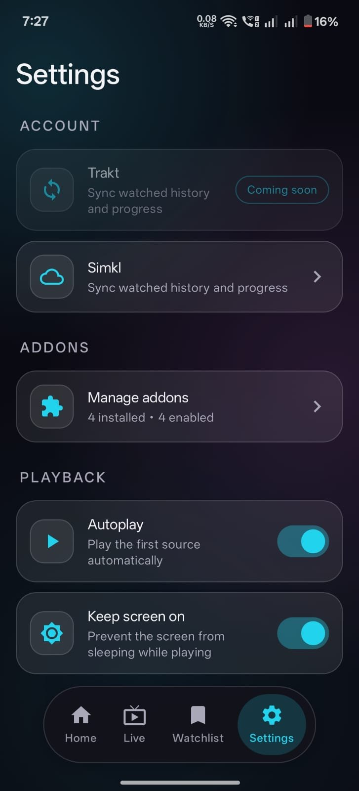
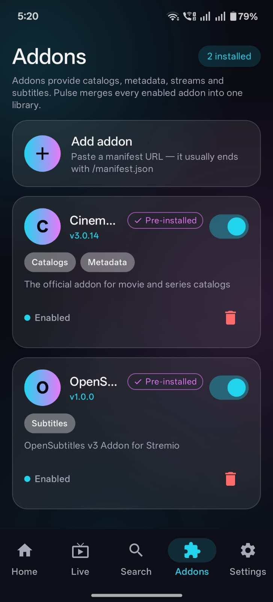

> **Note:** This project was previously developed at [KotlinJS5/PulseStream](https://github.com/KotlinJS5/PulseStream). That account ran into GitHub restrictions, so active development continues here. The Trakt sync integration will be built under this account.

# Plavio

A beautiful open-source streaming app for Android with a built-in player. Install addons to browse movies, series, and live TV — no account, no tracking.

> 📺 **Plavio for Android TV is in the works — coming soon.**

## Preview

| Home | Live |
|---|---|
|  |  |
| Settings | Addons |
|  |  |

## Features

- **Install addons** — paste any addon manifest URL (`…/manifest.json`) and browse its catalogs
- **Multi-addon merging** — separate addons can provide catalogs, metadata, and streams; Plavio combines them (details are fetched from every metadata addon, sources merged from every stream addon)
- **Movies, series & live TV** — details, posters, backdrops, genres, ratings; a dedicated Live tab for TV channels
- **Episode browser** — season / episode picker for series
- **One-tap Play** — the Play button starts the first available stream instantly
- **Gesture-rich built-in player** — ExoPlayer with HLS, DASH and progressive streams; swipe horizontally to seek, swipe right side for volume, left side for brightness, double-tap for ±10s, playback speed 0.5x–2x
- **Aspect-ratio button** — cycle Fit → Fill → Zoom while playing
- **Subtitle & audio track switching** — right from the player, plus in-player subtitle search
- **Skip intro / recap / outro** — Netflix-style skip button via the community IntroDB database
- **Continue watching** — your progress is saved on-device and surfaced on Home, with resume prompts
- **Watchlist** — bookmark movies and shows for later
- **Search** — across every catalog of every installed addon, with Movies / Series / Live TV filters
- **Settings** — autoplay, keep-screen-on, skip-intro toggle, and more
- **Material 3 dark glass-glow design** — deep blacks, frosted-glass cards, cyan→magenta neon accents

## Get the app

Download the latest APK from the [Releases](../../releases) page and install it on your Android phone (Android 8.0+).

## Add an addon

1. Open **Addons** → tap **+**
2. Paste the addon's manifest URL (it usually ends with `/manifest.json`)
3. Plavio validates it and adds its catalogs to your Home screen

Plavio ships with catalog, metadata, and subtitle addons pre-installed so it works out of the box — add more any time, or switch any addon off from the Addons screen.

## Build from source

Requirements: JDK 17, Android SDK (compileSdk 35), Gradle 8.10+.

```bash
chmod +x gradlew   # the executable bit isn't preserved by all push methods
./gradlew assembleDebug
# APK: app/build/outputs/apk/debug/app-debug.apk
```

> Note: `gradle/wrapper/gradle-wrapper.jar` is not stored in this repo — either
> run with an installed Gradle 8.10+ (`gradle assembleDebug`), or download the
> wrapper jar for Gradle 8.10.2 into `gradle/wrapper/` to use `./gradlew`.

## Tech

Kotlin · Jetpack Compose (Material 3) · Navigation Compose · Media3 ExoPlayer · OkHttp · Room · Coil · kotlinx.serialization

## Architecture

```
app/src/main/java/com/pulsestream/app/
├── data/
│   ├── StremioApi.kt        # addon protocol: manifest / catalog / meta / stream
│   ├── StremioParser.kt     # resilient parsing for real-world addon data
│   ├── StreamRepository.kt  # multi-addon merging (below)
│   └── db/                  # Room: installed addons (+capabilities), continue-watching
├── ui/
│   ├── screens/     # Home, Search, Addons, Detail, Player, Settings…
│   ├── components/  # glassmorphism cards, SafePosterImage
│   └── theme/       # Material 3 dark glass-glow theme
└── MainActivity.kt  # NavHost + bottom navigation
```

- **Multi-addon merging** — each addon declares its capabilities (catalog / metadata / stream). Catalogs aggregate across addons, metadata is tried across addons until one answers, streams are fetched concurrently from all stream addons and merged.
- **Player** — Media3 ExoPlayer: gesture controls (seek / volume / brightness), double-tap ±10s, speed 0.5x–2x, external subtitles, resume playback.
- **Offline-first** — addons and watch progress persist in Room. No backend, no account, no tracking.

## License

MIT — built for the love of streaming.
